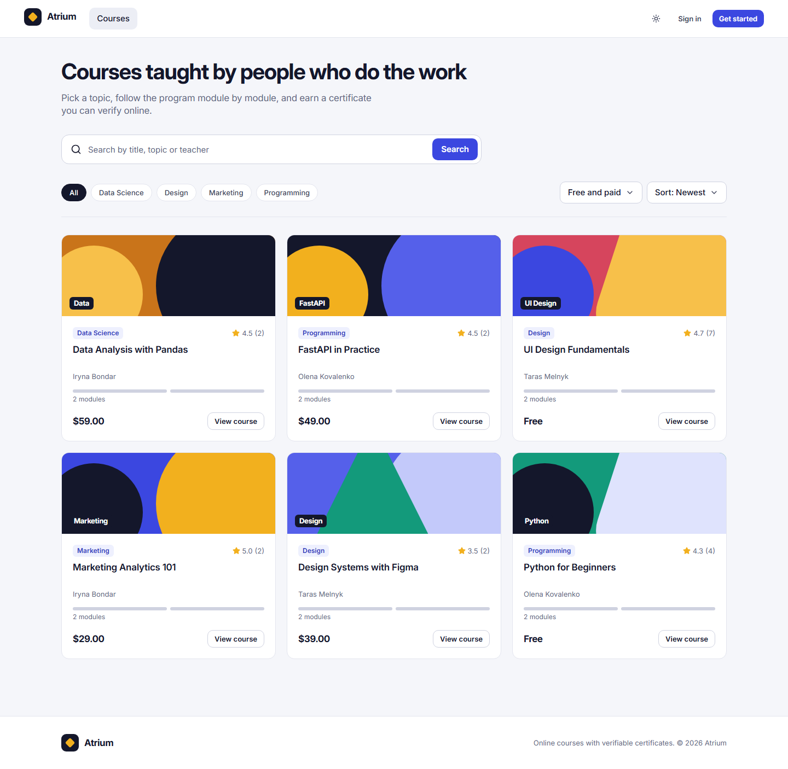
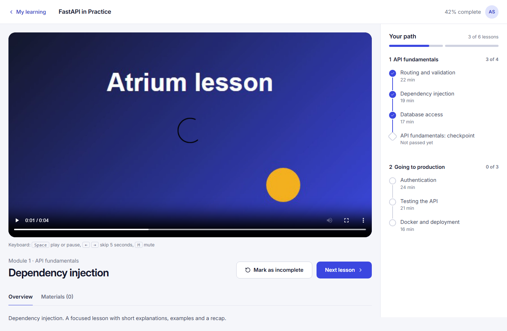
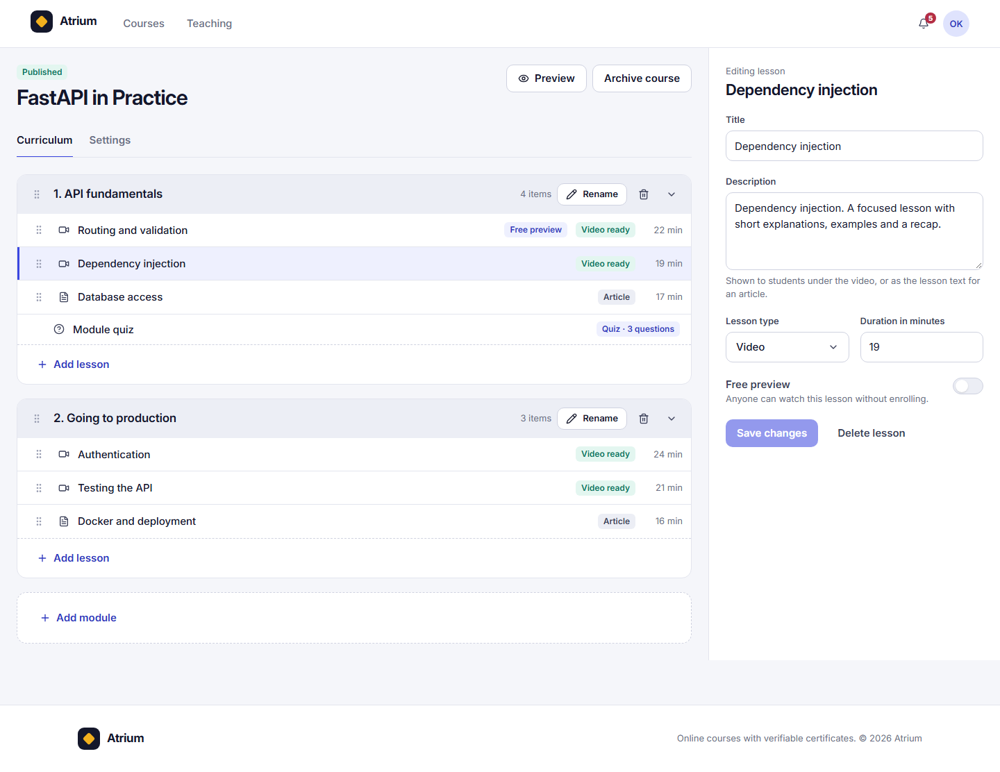
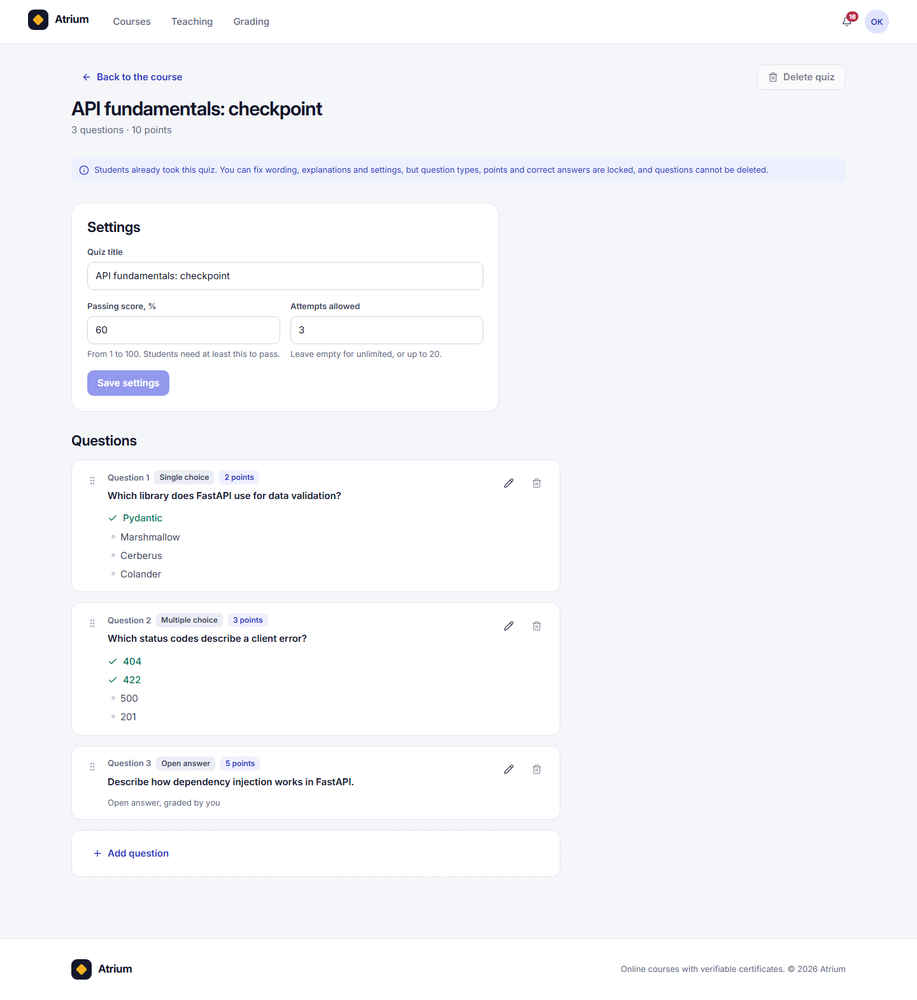
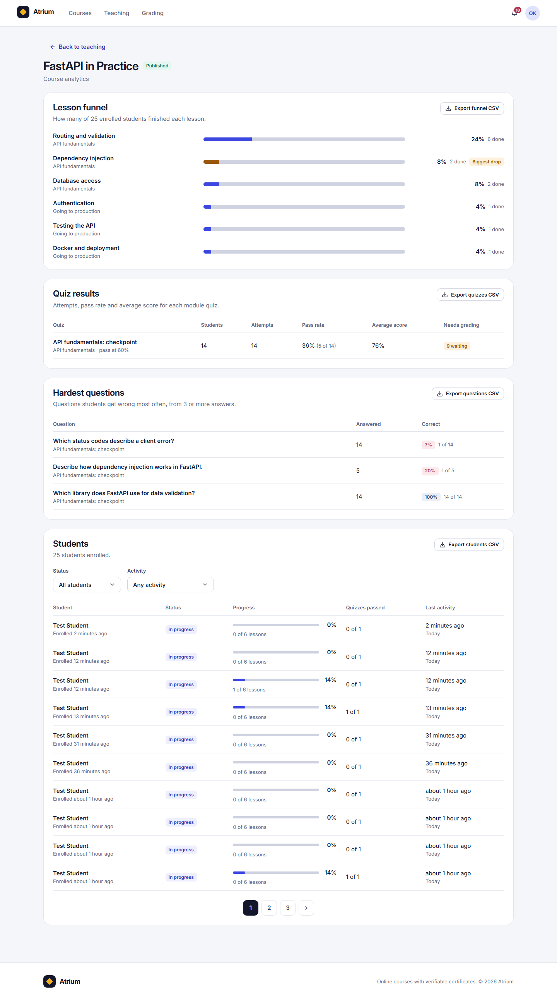
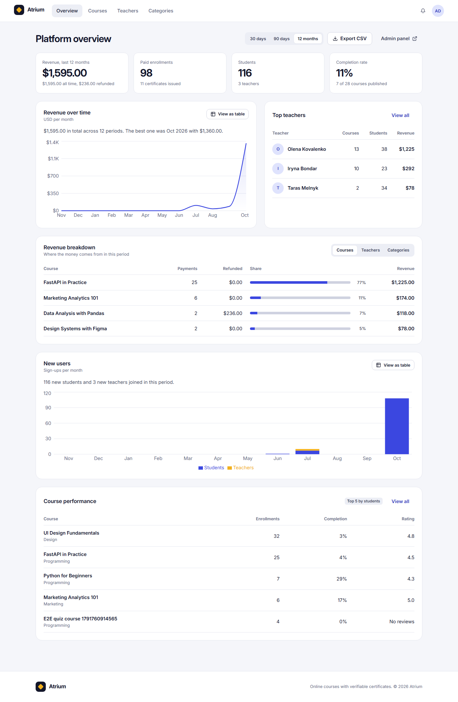
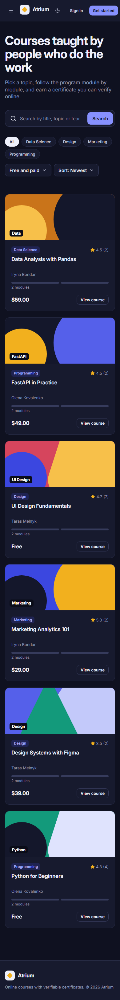

# Atrium frontend

Web client of the Atrium online education platform: course catalog, learning player with quizzes and certificates, live notifications, a teaching studio (curriculum and quiz builders, uploads, grading, analytics) and an admin area (platform overview, rankings, categories, CSV exports).

React 19, Vite, TypeScript (strict), React Router (data router), TanStack Query, Tailwind CSS v4 with shadcn/ui (Radix), react-hook-form with zod, `openapi-fetch` with types generated from the backend, dnd-kit, Recharts, sonner, date-fns, Vitest with Testing Library and MSW, Playwright, ESLint (flat config) and Prettier.

## Run it locally

Start the backend first (it lives next to this folder; see `docs/08-local-environment.md`):

```bash
cd ../food-delivery-backend
docker compose up -d --build
docker compose exec backend alembic upgrade head
docker compose exec backend python -m app.scripts.seed_demo
curl -s http://localhost:8000/health/ready
```

Then the frontend:

```bash
npm install
cp .env.example .env.local
npm run dev
```

Open `http://localhost:5173`. Demo accounts (password `Demo12345!`):

| Role    | E-mail                    |
| ------- | ------------------------- |
| Student | `andrii@demo.example.com` |
| Teacher | `olena@demo.example.com`  |
| Admin   | `admin@demo.example.com`  |

Sign-up codes arrive in Mailpit at `http://localhost:8025`.

## Environment variables

| Variable                | Default                 | Purpose                                                                                |
| ----------------------- | ----------------------- | -------------------------------------------------------------------------------------- |
| `VITE_API_URL`          | `http://localhost:8000` | Backend origin for REST, WebSocket and the admin panel link                            |
| `VITE_GOOGLE_CLIENT_ID` | empty                   | Google sign-in client id; the Google button is hidden when it is empty                 |

Both are read at build time and validated with zod in `src/config/env.ts`.

## Scripts

| Script                  | Purpose                                                                                    |
| ----------------------- | ------------------------------------------------------------------------------------------ |
| `npm run dev`           | Dev server on port 5173                                                                    |
| `npm run build`         | Type-check and build to `dist`                                                             |
| `npm run preview`       | Serve the production build                                                                 |
| `npm run typecheck`     | `tsc --noEmit`                                                                             |
| `npm run lint`          | ESLint with zero warnings                                                                  |
| `npm run format`        | Prettier write (`format:check` verifies)                                                   |
| `npm run check:comments`| Fails if any source file contains a comment                                                |
| `npm test`              | Vitest unit and component tests (MSW)                                                      |
| `npm run test:e2e`      | Playwright against the real backend with seed data                                         |
| `npm run api:types`     | Regenerate `src/api/schema.d.ts` from `http://localhost:8000/openapi.json`                 |
| `npm run check`         | Typecheck, lint, format check, comment check, unit tests and build; run before every commit |

End-to-end specs live in `e2e/`. They need the backend, Mailpit and RustFS running; the global setup checks `/health/ready` and the specs restart the Valkey container to clear rate limits (set `E2E_KEEP_RATE_LIMITS=1` to skip that). `e2e/a11y.spec.ts` runs axe on every screen in both themes and both widths. `e2e/screenshots.spec.ts` regenerates `docs/screenshots/` (`SCREEN=<name>` limits it to one screen).

## Structure

```
src/
  app/            router, layouts, guards, error and not found pages
  api/            typed client, generated schema, errors, query keys
  config/         validated environment
  components/     ui (shadcn/Radix), domain (cards, tables, dropzone), layout, feedback
  features/       one folder per area: auth, catalog, course, enrollment, learning,
                  quiz, reviews, certificates, notifications, profile, recommendations,
                  studio (builder, quiz, grading, analytics), admin
  hooks/ lib/     shared hooks and pure helpers
  styles/         Tailwind entry and design tokens
  test/           MSW server, factories, render helper
e2e/              Playwright specs and support (seed users, Mailpit, media)
docs/             specification, DECISIONS.md and screenshots
```

Features import each other only through their `index.ts`. Route modules are lazy and export a named `Component`. Money values stay strings end to end and are formatted in one place. Every query and mutation uses typed helpers over the generated schema; nothing hand-writes a type the schema already has.

## Deploy

The `Dockerfile` builds the app and serves it with nginx (SPA fallback, immutable asset caching, security headers, `/healthz`):

```bash
docker build -t atrium-frontend \
  --build-arg VITE_API_URL=https://api.example.com \
  --build-arg VITE_GOOGLE_CLIENT_ID=your-client-id .
docker run -p 8080:80 \
  -e API_ORIGIN=https://api.example.com \
  -e API_WS_ORIGIN=wss://api.example.com \
  -e STORAGE_ORIGIN=https://storage.example.com \
  atrium-frontend
```

`API_ORIGIN`, `API_WS_ORIGIN` and `STORAGE_ORIGIN` feed the content security policy so the browser may call the API, open the WebSocket and upload straight to object storage. The storage bucket must allow the frontend origin in its CORS rules (methods `GET`, `PUT`, `HEAD`, exposed header `ETag`), and the backend must list the frontend origin in `ALLOWED_ORIGINS`.

## Screenshots

Every screen is captured at 1440 and 390 px, in light and dark, in `docs/screenshots/<name>-<theme>-<width>.png`.

| Catalog                                                 | Lesson player                                                 |
| ------------------------------------------------------- | ------------------------------------------------------------- |
|      |  |

| Course builder                                               | Quiz builder                                                       |
| ------------------------------------------------------------ | ------------------------------------------------------------------ |
|  |  |

| Course analytics                                              | Admin overview                                                 |
| ------------------------------------------------------------- | -------------------------------------------------------------- |
|  |  |

| Dark theme, mobile                                          |
| ----------------------------------------------------------- |
|  |

## Decisions and backend changes

Choices the specification left open are one line each in `docs/DECISIONS.md`. Changes made in the backend repository are logged in `BACKEND_CHANGES.md` (two small additive ones, both tested and committed there).
